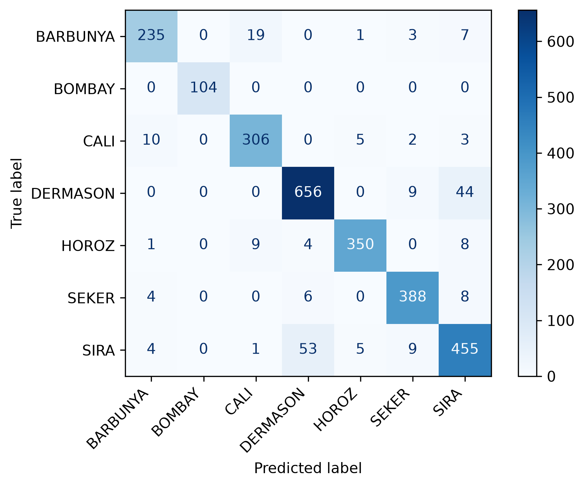
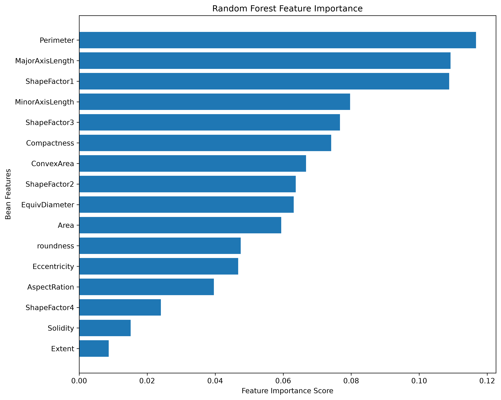

# Dry Bean Classification - Random Forest

## Project Overview

This project implements a supervised multiclass classification workflow for identifying seven dry bean varieties using sixteen numerical features describing their geometry and shape.

The project covers data preparation, Random Forest training, cross-validation, hyperparameter tuning, model evaluation, serialization, REST API development, and Docker containerization.

A FastAPI application provides a prediction endpoint and a server-rendered HTML/CSS interface.

The classifier operates on numerical measurements extracted from bean images. It does not process raw images or perform image recognition.

## Dataset and Preparation

The dataset is sourced from the UCI Machine Learning Repository.

- Original observations: 13,611
- Duplicate records removed: 68
- Cleaned observations: 13,543
- Numerical features: 16
- Target classes: 7
- Missing values: None
- Training observations: 10,834
- Testing observations: 2,709

The seven classes are BARBUNYA, BOMBAY, CALI, DERMASON, HOROZ, SEKER, and SIRA.

An 80/20 stratified train-test split was performed using `random_state=42`.

Stratification preserves the relative class distribution across training and testing partitions.

Duplicate removal was performed before splitting to reduce the risk of identical records appearing in both partitions.

## Model Training

A `RandomForestClassifier` was trained using the following configuration:

| Parameter | Value |
|---|---|
| n_estimators | 100 |
| criterion | entropy |
| max_features | sqrt |
| bootstrap | True |
| random_state | 42 |

Random Forest combines multiple Decision Trees trained on bootstrap samples.

Random feature selection introduces variation between individual trees. Predictions are aggregated to produce the final classification.

## Hyperparameter Tuning

Hyperparameter selection was performed using `GridSearchCV` with five-fold cross-validation.

The search evaluated:

| Hyperparameter | Values |
|---|---|
| max_depth | None, 12 |
| min_samples_leaf | 1, 3 |

Four combinations were evaluated using classification accuracy.

The selected configuration was:

- `max_depth=None`
- `min_samples_leaf=1`

The selected configuration matched the baseline model's cross-validation performance.

GridSearchCV refitted the selected estimator using the complete training partition.

The test partition was reserved for final evaluation.

## Evaluation Results

| Metric | Result |
|---|---|
| Baseline mean CV accuracy | 92.54% |
| Selected model mean CV accuracy | 92.54% |
| Training accuracy | 100.00% |
| Final test accuracy | 92.06% |
| Macro F1-score | 0.93 |
| Weighted F1-score | 0.92 |

The model achieved 92.06% accuracy on 2,709 test observations.

The training accuracy is substantially higher than the test accuracy. However, a fully grown Random Forest can fit its training observations closely.

The cross-validation accuracy of 92.54% and test accuracy of 92.06% are relatively close, providing a more useful indication of generalization on this dataset.

These results apply to the evaluated dataset and split. They do not establish performance on independently collected observations.

## Evaluation Artifacts

The training script generates and saves the following evaluation outputs:

- [Classification Report](classification_report.txt)
- [Confusion Matrix](confusion_matrix.png)
- [Feature Importance](feature_importance.png)

### Classification Report

The classification report contains precision, recall, F1-score, and support for all seven classes.

SIRA recorded the lowest F1-score at approximately 0.87, while BOMBAY achieved an F1-score of 1.00 on its 104 test observations.

Per-class evaluation is important because the dataset contains an uneven distribution of bean varieties.

### Confusion Matrix



The confusion matrix shows correct classifications and misclassifications across the seven classes.

It provides information about class-specific errors that overall accuracy does not capture.

### Feature Importance



Feature importance is calculated using the fitted Random Forest estimator.

The reported importance values represent normalized impurity reduction across the trees.

These values should not be interpreted as causal relationships.

Correlated features can also affect how impurity-based importance is distributed between measurements.

## Model Serialization

The selected estimator is serialized using `joblib`.

Saved model:

`random_forest_model.joblib`

The FastAPI application loads the serialized estimator for inference.

Training and inference are separate operations. API requests do not retrain the model.

The model's `feature_names_in_` attribute is used to preserve the input feature order established during training.

## FastAPI Prediction Service

The inference application is implemented using FastAPI.

### Endpoints

| Endpoint | Method | Purpose |
|---|---|---|
| / | GET | HTML prediction interface |
| /classify | POST | Browser form prediction |
| /predict | POST | JSON prediction API |
| /docs | GET | Interactive API documentation |

### Example Request

`POST /predict`

```json
{
  "Area": 28395.0,
  "Perimeter": 610.291,
  "MajorAxisLength": 208.1781167085,
  "MinorAxisLength": 173.8887470416,
  "AspectRation": 1.1971914241,
  "Eccentricity": 0.5498121871,
  "ConvexArea": 28715.0,
  "EquivDiameter": 190.1410972745,
  "Extent": 0.7639225182,
  "Solidity": 0.9888559986,
  "roundness": 0.9580271263,
  "Compactness": 0.9133577548,
  "ShapeFactor1": 0.0073315061,
  "ShapeFactor2": 0.0031472892,
  "ShapeFactor3": 0.8342223882,
  "ShapeFactor4": 0.998723889
}
```

### Example Response

```json
{
  "Prediction": "SEKER"
}
```

The field name `AspectRation` follows the original dataset spelling.

### Input Validation

Pydantic validates all sixteen numerical features.

- Positive measurements must be greater than zero.
- Bounded shape metrics must fall between zero and one.
- NaN and infinity values are rejected.
- Invalid requests return HTTP 422.

These checks validate individual field values. They do not establish that every combination of measurements describes a physically valid bean.

## Web Interface

The application includes a server-rendered interface using HTML, CSS, FastAPI, and Jinja2.

Users can submit sixteen numerical measurements and receive a predicted bean variety.

The interface uses server-side form processing and does not require JavaScript.

## Docker Containerization

Docker packages the inference application with its Python runtime, dependencies, serialized model, API, and frontend files.

The training dataset and training script are excluded from the inference image.

The Docker image was built and tested locally using Docker Desktop with the WSL 2 backend.

Both the REST API and HTML interface were verified inside the running container.

### Build

```bash
docker build -t dry-bean-api .
```

### Run

```bash
docker run --rm -p 8001:8000 dry-bean-api
```

After starting the container:

- Web interface: http://127.0.0.1:8001/
- API documentation: http://127.0.0.1:8001/docs

The application has not been deployed to a public hosting service.

## Local Installation

Python 3.14 was used for development.

Clone the repository:

```bash
git clone https://github.com/Vaibh37/dry-bean-random-forest.git
cd dry-bean-random-forest
```

Install inference dependencies:

```bash
python -m pip install -r requirements.txt
```

Start the application:

```bash
python -m uvicorn app:app --reload
```

Open:

- http://127.0.0.1:8000/
- http://127.0.0.1:8000/docs

## Training and Reproducibility

Training dependencies are maintained separately in `requirements-train.txt`.

Install them using:

```bash
python -m pip install -r requirements-train.txt
```

Place `Dry_Bean_Dataset.xlsx` in the repository root.

Run the training script:

```bash
python main.py
```

The script performs data preparation, model training, cross-validation, hyperparameter tuning, final evaluation, visualization, and model serialization.

Generated artifacts:

- `classification_report.txt`
- `confusion_matrix.png`
- `feature_importance.png`
- `random_forest_model.joblib`

A fixed random seed is used to support reproducibility.

## Automated API Tests

Automated API tests are implemented using pytest and FastAPI's TestClient.

Install test dependencies:

```bash
python -m pip install pytest httpx
```

Run:

```bash
python -m pytest test_api.py -v
```

Two tests are included:

1. A valid sample returns HTTP 200 and the expected predicted class.
2. A negative Area value returns HTTP 422.

Both tests passed in the local development environment.

## Limitations

- The experiment evaluates one dataset using a single stratified train-test split.
- Hyperparameter tuning covers four candidate configurations.
- Model selection uses accuracy rather than macro-F1.
- No independent external dataset evaluation was performed.
- The model requires sixteen numerical measurements and cannot classify raw images.
- Impurity-based feature importance may be affected by correlated predictors.
- Input validation does not enforce every physical relationship between measurements.
- The application has been tested locally but has not been publicly deployed.

Additional evaluation would be necessary before using the classifier in an operational setting.

## Data Attribution and Licensing

Dataset: Dry Bean — UCI Machine Learning Repository

Source: https://archive.ics.uci.edu/dataset/602/dry%2Bbean

DOI: https://doi.org/10.24432/C50S4B

The original dataset is distributed under Creative Commons Attribution 4.0 International.

The repository source code is distributed under the MIT License.

The MIT License does not replace the dataset's original license.
